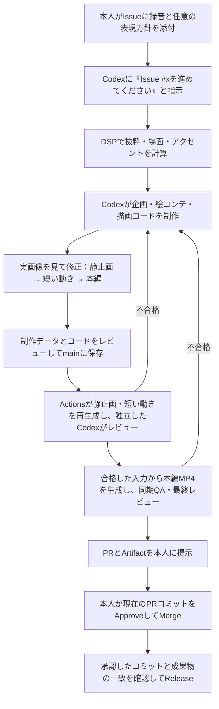

# Piano × Animation — Codex Studio

本人のピアノ演奏を使い、音楽に自動同期する縦型の短編映像を制作します。
タイミングを人が秒指定したり、毎回タイムラインを手編集したりしないことが最優先です。

**制作はCodexが一貫して担当します。GitHub Actionsは、保存された制作データの再現、検証、成果物保存を担当します。**
Museによるコンテンツ生成・修復は行いません。現在の画はローカルの手続き描画によるイラストで、生成動画APIは使っていません。

## 動画制作の流れ



制作担当のCodexは、色やカメラの数値だけでなく、必要な描画コードも修正します。
原音源・自動で決めた時刻・品質基準を守りながら実画像で検証します。
作業を再開するときも元のIssueを入口にでき、委任のための子課題分割は必須にしません。
Actionsが新しい子IssueやエンジニアリングIssueを自動で増やすことはありません。
既存作品の子Issue・制作PRは、承認と成果物の照合に必要な関連情報として引き継ぎます。

## 使い方

1. 録音をGitHub Issueに1件添付します。受付は `YusukeIwaki` のOpenなIssueだけです。公開リポジトリなので添付も公開されます。曲名・時期・表現方針は任意です。
2. このリポジトリのCodexセッションで「Issue #xを進めてください」と指示します。制作担当は `gpt-6.1-sol / xhigh` を第一候補にします。
3. Codexが保存する制作データは `studio/projects/issue-<番号>/` にあります。`project.json` は音源と既存制作Issueの対応、`brief.json` は企画とDSPの計画、`storyboard.json` は実行可能な描画設定です。人がこれらを毎回手編集する必要はありません。
4. コードと制作データをmainへ反映したら、[Studio production](https://github.com/YusukeIwaki/chopin-mood/actions/workflows/studio-production.yml)をmainから手動実行し、`issue_number` に親Issueの番号を指定します。Issueの投稿・編集だけでは制作モデルは起動しません。
5. 静止画・動きのレビュー結果は既存制作Issueのコメントに残ります。不合格なら制作担当のCodexが同じ作品を修正します。Actions内で別の制作モデルを起動する修復ループはありません。
6. 最終レビューまで合格すると、制作PRに担当者の割り当てと `@YusukeIwaki please check this` が付きます。Artifactの `video.mp4`、`timeline.html`、`qa.json`、`review.json` を確認します。
7. 本人による現在のコミットへのApproveとMergeを確認したものだけReleaseします。エージェントは制作PRを自動承認・自動マージしません。

現在のActions入力は、既存制作Issueに紐づく保存済みプロジェクトです。
未登録のIssueを指定した場合は止まり、自動で企画や子課題を生成しません。新作の受付一般化より、まず再現できる完成例を作る段階です。

## 品質と同期

- 元の本人演奏を保持し、DSPがサンプル／フレーム単位で時間を決めます。LLMの感情解釈から秒数を決めません。
- 場面境界を動かさず、その前後で色・光・カメラを自動補間し、急な画面全体の変化を抑えます。
- 静止画レビューに合格してから短い無音プレビュー、両方に合格してから本編へ進みます。
- 画像・レビュー・制作入力・実行番号・コミットのハッシュを照合し、別の生成物の承認を流用しません。
- 補間の時刻は、圧縮後の映像を、同じ圧縮を通した前後の境界モデルと比較して検証します。圧縮による誤差より十分に区別できない場合は同期を確認済みとせず停止します。既知のずれを使って校正する機械検査であり、音楽的自然さの評価とは分けます。
- **機械QAの合格と、美的・音楽的な合格は別です。** Actionsが緑になったことだけを公開承認としません。
- 動きの途中レビューは短いプレビューの抽出画像を用います。全編の動きや音楽的自然さを保証するものではありません。音声聴取の評価は未実施です。
- 高額な生成API、外部への演奏送信、YouTube投稿は承認なしに行いません。

## ローカル開発

Python 3.13、uv、ffmpeg／ffprobeを用意します。

```bash
uv venv --python 3.13
uv pip install -r requirements-p0.txt
.venv/bin/python -m pytest tests -q
.venv/bin/python scripts/studio_smoke.py --out output/studio-smoke
```

合成信号のsmokeには個人の録音やSecretは不要です。
`assets/reference_audio.wav` はクローン直後には存在しません。

| 用途 | 文書 |
| --- | --- |
| 制作担当のルール | [AGENTS.md](AGENTS.md) |
| Actions・承認・公開の運用 | [Studio運用](docs/10_GITHUB_STUDIO_OPERATIONS.md) |
| ローカルのコマンド | [開発ガイド](scripts/README.md) |
| 目的 | [背景と目的](docs/01_CONTEXT_AND_GOALS.md) |
| 同期設計 | [音響解析と同期](docs/03_AUDIO_AND_SYNC.md) |
| 方式判断 | [アーキテクチャ判断](docs/09_ARCHITECTURE_DECISION_AND_ACCEPTANCE.md) |
| 実験の測定証跡 | [P0実測](docs/07_DESIGN_REVIEW_AND_P0.md)・[独立レビュー](docs/08_INDEPENDENT_SIGNAL_REVIEW.md)・[レート校正](docs/11_SAMPLE_RATE_TUNING.md) |
