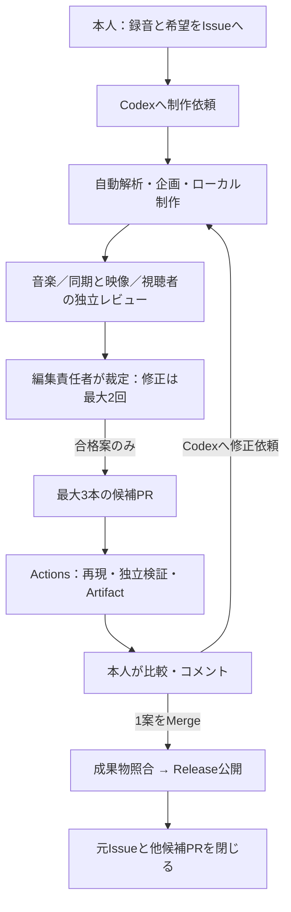

# Piano × Animation — Codex Studio

本人のピアノ演奏から、音楽に同期する縦型の短編映像を制作します。
目指すのは、演奏を主役にした、素朴でも見飽きない作品です。抜粋・場面境界・アクセントは音源から計算し、人が毎回タイムラインを合わせる運用にしません。

制作はCodex、再現検証と成果物保存はGitHub Actionsが担当します。Museへのコンテンツ委任や、Issue投稿だけで始まるモデル処理はありません。

## 動画制作の流れ

1. **Issueに録音と希望を書く。** 切り取る前の本人演奏を1件添付し、雰囲気や避けたい表現を書きます。曲名・時期は任意です。受付は `YusukeIwaki` が作成したOpenなIssueに限ります。このリポジトリの添付は公開されます。
2. **Codexに制作を頼む。** このリポジトリで「Issue #103 の映像作品化をお願いします」と依頼します。Codexが解析・抜粋選択・企画・素材・描画・検証を進めます。子Issueへの分割は不要です。
3. **最大3案のPRを受け取る。** 1案につき1PRです。Codexは静止画、短い動き、本編をローカルで確認し、独立レビューを経た案を提出します。3案を埋めるために似た案や未合格案を増やしません。ActionsがそのPRの保存入力から再現し、同期QAと独立した映像レビューを通した動画をArtifactに保存します。確認可能になったPRには `@YusukeIwaki please check this` が付きます。
4. **修正希望をPRに書く。** 「Pull Request #104 のコメントに対応してください」とCodexに依頼します。コメントだけで勝手に制作は再開しません。
5. **同じPRで修正版を確認する。** Codexは要望と対応結果を整理し、変更した実映像を再検証します。古い動画の合格結果は流用せず、新しいコミットに対応するArtifactを提示します。
6. **採用するPRを本人がMergeする。** Mergeを採用・公開の意思表示として扱います。Actionsが採用コミットと検証済みArtifactを照合してReleaseを作り、**公開成功後に**元Issueと他の候補PRを閉じます。新方式では別途Approve操作は必須ではありません。エージェントは制作PRを自動Mergeしません。



Artifactの `video.mp4` が作品、`timeline.html` が同期の可視化です。
`qa.json` は機械検査、`editorial.json` はローカルの独立レビューと裁定、`review.json` はActionsの映像レビューです。
Releaseには採用動画とこれらの検証記録を保存します。YouTubeへの自動投稿は行いません。

## 品質の決め方

制作担当と、音楽・同期を見る担当、構図・動き・飽きやすさを見る担当を分けます。
レビューは実際の画像・動画・検査結果に基づきます。「もっと派手にする」「何も動かさない」のどちらも正解とは決めず、演奏と希望に対して必要な変化かを確かめます。

意見が割れた場合は編集責任者が理由を残して決定します。初回制作に対して修正は最大2回。同期失敗、証拠不足、本人の明示した制約への違反は裁定で免除できません。合格に届かなければ、合格済みの別案を出すか、未合格と理由を報告します。本人から新たな修正依頼が来た場合は、その依頼を単位に再開します。

**機械的同期、美的品質、音楽的自然さは別評価です。** 聴取できない環境ではその限界を明記し、数値や静止画だけで「音楽的にも自然」と断定しません。モデルの感情解釈や曲名推測も音楽的事実として扱いません。

## 開発と運用

- 制作手順：[studio-produce](.agents/skills/studio-produce/SKILL.md)
- 独立レビュー：[studio-review](.agents/skills/studio-review/SKILL.md)／[裁定](.agents/skills/studio-arbitrate/SKILL.md)
- 制作データ：`studio/projects/issue-<番号>/candidates/cand-01/`（最大 `cand-03`）
- 運用・再実行・既存作品：[Studio運用](docs/10_GITHUB_STUDIO_OPERATIONS.md)
- エージェントの恒久ルール：[AGENTS.md](AGENTS.md)
- 開発コマンド：[scripts/README.md](scripts/README.md)
- 音響解析と限界：[同期設計](docs/03_AUDIO_AND_SYNC.md)／[目的](docs/01_CONTEXT_AND_GOALS.md)

新しい描画機能・固定素材はエンジン側でレビューしてから使用します。候補PRには実行コードや録音を含めず、Actionsは信頼済みのエンジンで再現します。本人演奏を外部モデルへ送らず、有料生成API・外部アップロード・投稿は承認なしに実行しません。

Python 3.13、uv、ffmpeg／ffprobeを用意すると、個人の録音・Secretなしで検証できます。

```bash
uv venv --python 3.13
uv pip install -r requirements-p0.txt
.venv/bin/python -m pytest tests -q
.venv/bin/python scripts/studio_smoke.py --out output/studio-smoke
```

`assets/reference_audio.wav` や過去のローカル生成物はクローンには含まれません。P0の測定文書は実験記録であり、現在の作品品質を保証するものではありません。
