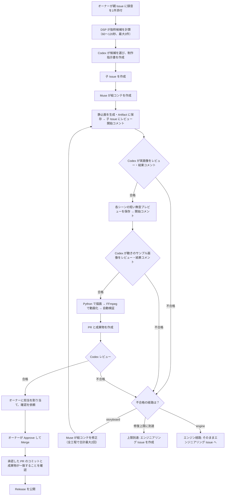

# Piano × AI Animation — GitHub Studio

ピアノ演奏の録音を GitHub Issue に投稿すると、元の演奏音源に合わせて自動で同期した縦型 MP4 を作る仕組みです。
目標は、音源の投入から書き出しまで、手作業でタイミングを調整しないことです。
現在の映像は手続き描画（プログラムで図形を描く方式）のプロトタイプで、完成した AI アニメではありません。

## 制作の流れ

受付はオーナー（YusukeIwaki）だけです。対象は、未クローズ（Open）の親 Issue に添付された音声／動画ファイル1件です。
元の音源は60秒以上が必要です。このリポジトリは公開されているため、添付した録音も公開されます。
曲名・時期・画風などの指定は任意で、未指定の場合は unknown として扱います。
まず DSP（音声の信号処理）で録音を解析し、抜粋候補を計算します。



Release の公開後に対応する子 Issue を閉じます。
すべての子 Issue が Release 済み、またはオーナーが明示的に却下した場合にだけ、親 Issue を閉じます。

途中の Issue コメントには、実画像の Artifact、レビュー結果、修復指示が残ります。コメントへの返信や人間の途中承認は不要で、同じ Actions 実行内で検証済みのレビュー JSON に従って進みます。静止画が不合格なら動きの確認へ進まず、どちらかが不合格なら本編を書き出しません。そのため、新しい制作 PR ができる前にエンジニアリング Issue へ引き継ぐ場合もあります。

絵コンテで直せるものは、ブロッカーと修復指示の全文を保持したまま Muse が自動修正します。修復は途中レビューと本編レビューを合わせて最大2回です。変更した絵コンテは静止画から再確認し、元のタイミング（抜粋区間・場面境界・アクセント）は変更しません。上限到達、修正による進展なし、エンジンの機能不足の場合はエンジニアリング Issue へ引き継ぎます。

本編の最終レビューまで合格した場合にだけ、オーナーに担当を割り当て、PR に `@YusukeIwaki please check this` とコメントします。途中レビューの合格は、最終承認ではありません。

Actions が成功しても、それだけで品質が承認されたことにはなりません。
公開するには、自動レビューの合格に加えて、現在の PR コミットに対するオーナーの承認（Approve）、オーナーによる Merge、成果物の一致確認がすべて必要です。

## 用語

- DSP（音声の信号処理）: 録音を解析し、抜粋候補やタイミングの基礎データを計算する処理です。
- 制作指示書（brief）: Codex が作る、抜粋や表現方針をまとめた指示データです。
- 絵コンテ（storyboard）: Muse が作る、場面構成を宣言的に記述したデータです。

## 役割分担

| 担い手 | 役割 |
| --- | --- |
| DSP（音声の信号処理） | サンプル／フレーム単位のタイミングを決めます |
| Codex `gpt-6.1-sol` / `xhigh` | 候補の選択、制作指示書の作成、証拠と品質のレビュー |
| Muse `muse-wonder-1.0-contributor` / `max` | 絵コンテの作成 |
| レンダラー（GitHub Actions の実行環境） | Python（Pillow）が QA 文字やマーカーのないクリーンなフレームを決定的に描画し、FFmpeg が動画の符号化と音声の多重化を行います。絵コンテから反映できるのはパレット6色と10パラメータ（うちカメラ6件は任意）で、`motif`／`camera` の説明文はプログラムとして実行しません |

モデルには元の音声を渡しません。創作上の解釈は、音楽学的な事実ではありません。
モデルや実行環境の詳しい設定は[運用手順](docs/10_GITHUB_STUDIO_OPERATIONS.md)をご覧ください。

## 使い方

1. [Issue フォーム「Studio source recording」](https://github.com/YusukeIwaki/chopin-mood/issues/new?template=studio-source.yml) から、録音を1件添付して親 Issue を作ります。通常の Issue に録音を1件添付しても受け付けます。曲名・時期・アートメモは任意です。カットする秒数を入力する欄はありません。
2. 子 Issue のコメントで、静止画・動きの確認と修復の進行を確認できます。秒数の指定やタイムラインの手編集は不要です。
3. 本編の PR が作られたら、Artifacts（成果物）から `video.mp4`、`timeline.html`、`qa.json`、`review.json` を取得して確認します。途中の画像とレビュー履歴も Artifact に保存し、保持期間は90日です。
4. Codex レビューで合格した場合にだけ、担当の割り当てと確認依頼のコメントが付きます。オーナーが現在の PR コミットを Approve して Merge すると、承認した PR のコミットと成果物が一致することを確認したうえで、Release として公開します。

エンジニアリング Issue は、コード変更が必要な次の一手です。**エンジンのコードを自動で書くジョブはまだありません**。実際のコードエージェントはその Issue から作業し、別のエンジニアリング PR を作ります。その PR のレビューと Merge が終わってから、オーナーが元の音源 Issue で制作を手動 dispatch します。対応していない機能が自動で直るわけではありません。

作り直したい場合は、[Actions の Studio production](https://github.com/YusukeIwaki/chopin-mood/actions/workflows/studio-production.yml) を `main` から手動で実行し、`issue_number` に親 Issue の番号を指定します。手動再実行は、コード修正後や利用上限の解消後に使うもので、通常の絵コンテ反復に手動再実行は不要です。
管理者向けの初期設定（4つの Secret など）は[運用手順](docs/10_GITHUB_STUDIO_OPERATIONS.md)をご覧ください。

## ローカル開発（最小）

前提は Python 3.13、uv、ffmpeg／ffprobe です。リポジトリ直下で次を実行します。

```bash
uv venv --python 3.13
uv pip install -r requirements-p0.txt
.venv/bin/python -m pytest tests -q
.venv/bin/python scripts/studio_smoke.py --out output/studio-smoke
```

`studio_smoke.py` は合成信号だけを使うため、個人の録音や Secret は不要です。
従来の P0（30〜45秒のオフライン比較）・プレビュー・校正の手順は[開発ガイド](scripts/README.md)をご覧ください。
`assets/reference_audio.wav` はクローン直後には存在しないため、初期手順の前提にしていません。

## 制限

- DSP が出す境界候補は、検証された音楽的フレーズと等しいものではありません。
- 音声を聴いての検証はしていません。モデルは元の音声を受け取りません。
- 動きの途中レビューは各シーン最大2秒の無音プレビューから抽出した画像を確認します。全編の連続した動きや音楽的な自然さを保証するものではありません。
- 機械的な自動検証の合格は、音楽的・美的な合格とは別です。新しいデコード済み参照フレーム QA は、符号化された動画が決定的な描画と機械的に対応するかを確認するもので、美的・音楽的な真実を判定しません。
- 生成素材の統合は今後の課題です。現在の手続き描画は完成したアニメではありません。
- 有料の動画生成や YouTube への投稿は、既定では行いません。

## ドキュメント

| 用途 | 文書 |
| --- | --- |
| 運用・管理 | [Studio 運用](docs/10_GITHUB_STUDIO_OPERATIONS.md) |
| ローカル開発 | [開発ガイド](scripts/README.md) |
| エージェント規約 | [AGENTS.md](AGENTS.md) |
| 目的・要件 | [背景と目的](docs/01_CONTEXT_AND_GOALS.md) |
| 同期設計 | [音響解析と同期](docs/03_AUDIO_AND_SYNC.md) |
| 方式判断 | [アーキテクチャ判断](docs/09_ARCHITECTURE_DECISION_AND_ACCEPTANCE.md) |
| 測定証跡 | [P0 実測](docs/07_DESIGN_REVIEW_AND_P0.md)・[独立レビュー](docs/08_INDEPENDENT_SIGNAL_REVIEW.md)・[レート校正](docs/11_SAMPLE_RATE_TUNING.md) |
