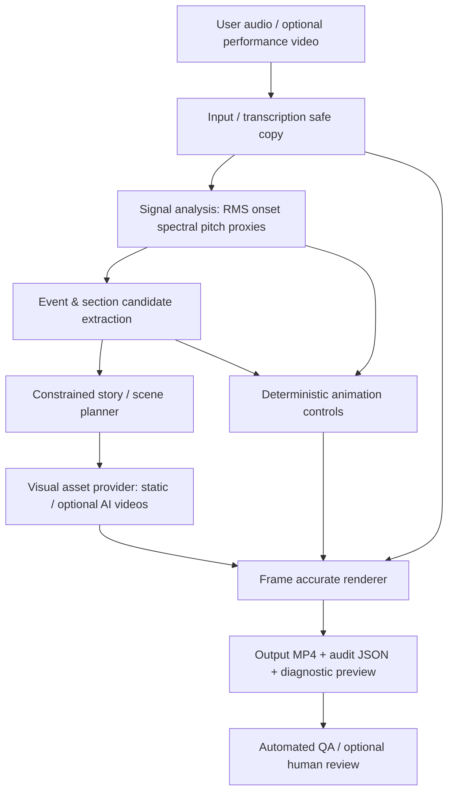

# 02 — 暫定アーキテクチャ（選定前）

## 処理の流れ



### 5層と責務

1. `ingest`: 元音源・動画の取り込み、動画から音声抽出、デコード、原本の保管、クリップ切り出し。
2. `analyze`: デジタル信号処理で連続曲線とイベント候補を作る。将来はMIDIや楽譜、映像の手の動きも入力できる。
3. `plan`: LLM/ルールベースで場面の意味と長さ、画風、アセット要求を確定。**有効時間域・最短シーン長・境界候補から逸脱しない**。
4. `assets`: 静止画・レイヤー画像・動画をプロバイダー抽象化して調達。高額APIは後付け。
5. `render`: 音源タイムラインを真として自動映像化。同期・画角・音質・シード・バージョンを記録。

## 推奨するデータ契約の草案

内部時刻は `[start_sample, end_sample)` または同等の有理数的表現が望ましい。API境界では `start_sec` / `end_sec` の浮動小数値を使う場合も、最終レンダリングでは fps と原音声のサンプル位置から一貫して丸める。

### analysis.json（イメージ）

```json
{
  "schema_version": "0.1",
  "asset_id": "sha256-or-uuid",
  "sample_rate": 22050,
  "duration_sec": 167.145,
  "analysis_hop_sec": 0.02322,
  "features_uri": "features.npz",
  "sections": [
    {"start_sec": 20.0, "end_sec": 35.0, "label": "high_activity", "confidence": 0.61, "method": "heuristic_v0"}
  ],
  "events": [
    {"time_sec": 28.2, "kind": "activity_peak", "confidence": 0.73, "strength": 0.77, "method": "heuristic_v0"}
  ],
  "semantic_interpretation": null
}
```

※上の `sections`・`confidence` は**スキーマ説明用のダミー値**。検出済み事実や信頼度推定結果ではない。`events.time_sec=28.2` は旧解析の値に基づく候補。

### storyboard.json（イメージ）

```json
{
  "schema_version": "0.1",
  "clip": {"start_sec": 20.0, "end_sec": 60.0, "fps": 30},
  "narrative": "night storm to dawn; original interpretation, not composer intent",
  "style_id": "watercolor-anime-original-v1",
  "scenes": [
    {
      "id": "scene01",
      "start_sec": 20.0,
      "end_sec": 35.0,
      "narrative_role": "tension",
      "asset_prompt": "A lone traveler in a storm, original anime design",
      "asset_type": "still_image",
      "motion_preset": "slow_parallax",
      "reactivity_profile": "restrained",
      "transition": "crossfade"
    }
  ],
  "credits": {"piano_performed_by": "artist-provided-name"}
}
```

※サンプルは部分例であり、シーン網羅・隙間なし等のバリデーションは未実装。

### motion/control.json（実装の単位）

- `camera_x(t)`, `camera_y(t)`, `zoom(t)`：ゆっくり滑らかに変化。
- `lighting(t)`：連続音量を平滑化＋ヒステリシス＋変化速度制限。
- `particles(t)`：密度を構造・活動度で変更、瞬間的アクセントで限定的な効果。
- `scene_switch(t)`：フレーズ境界の候補から決定。すべてのonsetで切り替えない。
- `palette(t)`：楽曲のセクション単位で変化。音色の明るさだけで即変更しない。

時間関数は `t` のみに依存し、前後フレームの描画順や環境によって値が変わらないこと。長い時定数の制御用時系列は事前にプリコンピュートできる。

## 技術スタック候補（未決定）

- 音響: Python + librosa + NumPy/SciPy; 必要なら Essentia。初期には充分。
- シーン提案: LLM + JSON Schemaによる構造化出力（推論モデル/プロンプト評価はこれから）。
- 静止画/動画: 各社画像生成・動画生成APIを交換可能なadapterに。
- 描画/編集: **Remotion（React/TS）** または Python/FFmpeg/Blender等。Remotionはフレーム駆動・音声を使った可視化の公式機能がある。ただし、最適とは決め打ちしない。
- CLI/ジョブ制御: MVPは `analyze`, `plan`, `render`, `evaluate` などの明確なコマンドで十分。

## 外部サービスの境界

- P0はAIサービス無しでエフェクト用プレースホルダーや手持ち静止画を使う。
- P1でLLMによる scene planning をオプションに追加。
- P2で商用利用できる画像・動画生成APIを追加。
- APIごとに `generation_cost`, `model_version`, `seed`, `input_hash`, `license_notes` を記録。

## セキュリティ・コスト

- 原音源や演奏動画を外部に自動送信しない。明示したデータだけ送信。
- モデルの試行回数・予算上限・失敗時のフォールバックを設ける。
- 演奏音源・映像と、生成出力との権利と来歴をロギングする。
