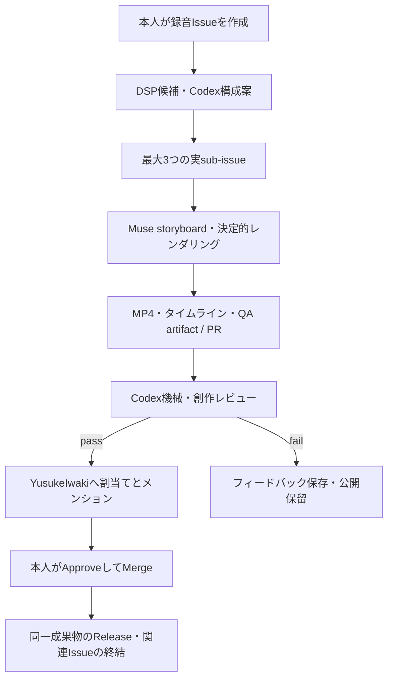

# 10 — GitHub Studio 運用（初期実装）

更新: 2026-10-21。対象は GitHub Actions 上の制作スタジオ初版。
mainへの導入、認証smokeの成功後に受付を開始する。初版は手続き描画による制作フローの検証であり、完成アニメの品質は保証していない。

## ユーザーの操作（1〜2分）

1. GitHub Issue フォーム「Studio source recording」から演奏（音声/動画）を
   **GitHub 添付として1件だけ**アップロードし、Issue を作る。
   任意で曲名（不明が既定）・時期（創作上の方向付け、下記）・アートメモを書く。
   **カット秒の指定欄はない。手作業のタイミング調整は存在しない。**
   通常のIssueに録音を1件添付するだけでも受け付ける。この場合は本文の自由記述を
   アートメモとして引き継ぎ、曲名・時期は未確認として扱う。
2. あとは自動で進む（下記フロー）。ユーザーが触るのは最後の PR レビューだけ:
   Codex レビュー通過時にだけ `@YusukeIwaki please check this` という
   COMMENT レビューと担当者割り当てが付くので、再生して確認し、
   問題なければ **Approve → Merge** する。
3. Merge された PR は、承認時と同一の head SHA・同一 artifact が
   検証できた場合にのみ Release `studio-pr-<PR番号>` として公開される。

このリポジトリは公開されているため、Issue添付の録音も公開アクセス可能になる。

GitHub 自体の添付上限（2026-10 公式）: wav/mp3 は 25MB、動画は無料 10MB /
有料 100MB。コントローラの 512MB 上限は防御であり、GitHub の許可量ではない。

## フローと担い手

| 段階 | 担い手 | 実体 |
|---|---|---|
| 受付 | `studio-production.yml` preflight | author/sender ともに `YusukeIwaki`、Issue open、添付ちょうど1件。満たさなければ job summary に理由を書いて正常終了（graceful skip） |
| 企画 | DSP + Codex `gpt-6.1-sol` / xhigh（15分上限） | `scripts/studio_analyze.py` が 60〜120秒候補を最大3件（多様性フィルタ、強制はしない）。Codex は候補 **ID のみ**を選択（秒の発明は検証で却下）。子 Issue を実 sub-issue API で作成 |
| 制作 | Muse `muse-wonder-1.0-contributor` / max（≤80 steps、Muse実行40分上限／制作job全体70分上限） | Docker内で宣言的 storyboard JSON を作成。マウントはbrief/schema/promptとMuse専用認証だけ。ホストのレンダラー・GitHub認証・音源はマウントしない |
| 描画/QA | 信頼レンダラー `scripts/studio_render.py` | storyboard のパレット/パラメータを実際に消費する手続き描画（**完成アニメではないプロトタイプ**）。符号化済み MP4 への QA（`p0/qa.py`）を実施 |
| 審査 | Codex（contact-sheet 画像付き、15分上限） | 機械QA・brief準拠・タイミング完全性・美的承認の4項目が全てtrueかつblockerなしの場合のみpass。**音声の聴取はできていない**ため音楽的判断とは扱わない |
| 公開 | `studio-release.yml` | exact-head の本人 Approve（COMMENT は承認を消さない／CHANGES_REQUESTED・DISMISSED は無効）→ 本人 Merge → 成功した production run と artifact hash の照合 → draft Release に資産を載せて検証後に公開。子 Issue を閉じ、全子が終端（公開済み or 本人が not_planned で明示却下）のときだけ親を閉じる |

PR 本文に `Fixes #child` は書かない（release 成功前に子が閉じてしまうため）。
自動マージ・botのAPPROVE・YouTube API・音声のモデルAPI送信は行わない。GitHubにはユーザーが添付した録音と、承認フローで作成したMP4が置かれる。
音声をモデル API に送ることもない（モデルが見るのは有界な DSP JSON と画像証拠のみ）。

## セットアップ（親 Codex / 管理者）

1. リポジトリ Secrets に正確に4件を登録:
   `CODEX_ENC_APP_ID`, `CODEX_ENC_APP_PRIVATE_KEY`, `CODEX_ENC_PASSPHRASE`,
   `MUSE_ENC_PASSPHRASE`。GitHub App は `YusukeIwaki/codex.enc` と
   `YusukeIwaki/muse.enc` の clone/更新専用。プロジェクト変更は `GITHUB_TOKEN`。
2. Settings → Actions → General で
   **「Allow GitHub Actions to create and approve pull requests」** を有効化する
   （公開リポジトリの既定は read + `can_approve_pull_request_reviews=false`）。
   本スタジオは COMMENT レビューしか出さないが、PR 作成に必要。
3. Default branchは`main`。productionはmainのイベントSHAを固定してcheckoutし、手動実行もmain限定。releaseは信頼するmainをcheckoutする。いずれも`persist-credentials: false`。
4. Codex は `0.144.6` 固定 + Node 24。Muse は公式 launcher
   (`https://api.meta.ai/muse-launcher.sh`、muse.enc の Dockerfile と同方式)
   でDockerイメージ内に導入し、実バージョンをrunログに記録する。
5. Actions → Studio auth smokeを手動実行し、両モデルの実認証を確認してから録音Issueを作る。`invalid_refresh_token`ならCodexを再ログインしてcodex.encを更新する。Muse認証の更新先はmuse.encで、Linuxでは`$XDG_CONFIG_HOME/muse/auth.json`へ復号する。

### 認証ライフサイクル

- read token で `.enc` リポジトリを clone → **エージェント実行前に read token を失効**。
- 復号は `RUNNER_TEMP` 配下のみ。Codex は `auth_mode == "chatgpt"` かつ
  `tokens.refresh_token` あり、Muse は keychain ではない schema-v1 の
  実トークン JSON であることを検証する（中身は決して表示しない）。
  Linux の Muse 認証は `$XDG_CONFIG_HOME/muse/auth.json`。macOS の
  keychain ポインタは移植できない。
- エージェント後に hash が変わった場合のみ AES-256-CBC/PBKDF2/base64 で
  再暗号化し、write token を新規に作って **force なし**で push する。
  clone 時点から remote が動いていたら credentials の rebase はせず失敗させる。
- **既知の注意**: codex.enc / muse.enc への同時書き込みは別リポジトリの
  ワークフローとも競合しうる。失敗安全側に倒れる（上書きしない）ので、
  その場合はワークフローを再実行すること。

## 再実行・手動操作

- 失敗した制作を再試行する: Actions → Studio production → Run workflow に
  source issue番号を入れる（実行者もownerのみ）。保存済みの企画と候補を再利用し、終了済みの子Issue/PRは制作対象から除外する。
- 創作的に却下された場合: 初版には**自動修復ループはない**。PR/Issue の
  フィードバックを確認し、productionワークフローを再実行する。前回のbotレビューはMuseへの再試行入力に含める。秒指定・タイミング修正は不要。
- Release の再試行: Actions → Studio release → Run workflow に PR 番号。
  既存 Release の資産が食い違う場合は黙って上書きせず失敗する。
- ソースや brief を変えたい: 既存の承認済み作業は上書きしない。
  **新しい source Issue を開く**こと（初版の制約）。

## 制限と正直な境界

- **音楽の聴取は未検証**。候補選択は DSP の音響ランキングであり、
  音楽的良否の証明ではない。端点の根拠と懸念は JSON に保存される。
- 描画は手続きプロトタイプであり、完成したアニメ作品ではない。
  実生成アニメのプロバイダは将来の差し替え対象（時刻決定権は渡さない）。
- 時期の解釈（early=プロ演奏への憧れ、middle=コンサートの存在感と表現、
  late=癒し）は**創作上の方向付けであり歴史的・音楽学的事実ではない**。
  曲名・時期は任意で既定は unknown。添付録音を特定の曲と同定しない。
- 60秒未満の音源は actionable なエラーで止まる（隠れた padding/stretch なし）。
- 秒単位のイベントはネイティブサンプル/30fps フレームで検証する。
  固定 BPM グリッドは使わない。
- artifact は 90 日保持。原録音の全体は Issue 添付と一時ワークスペース
  のみに存在し、git・plan artifact・Release には入れない。

## ローカル検証（オフライン）

```bash
.venv/bin/python -m pytest tests -q
.venv/bin/python scripts/studio_smoke.py --out output/studio-smoke
.venv/bin/python -m studio validate-url --url https://github.com/user-attachments/files/1/x
```

`studio-ci.yml` は secret・モデル・個人音源なしで同じ tests と
60秒以上の合成レンダリング smoke を実行する。


## 証跡バインディング（receipt）と再試行の正確さ

- repo に commit されるのは安定した制作ソース（brief/storyboard/plan/qa/
  provenance/timeline.json）のみで、そのハッシュに最終 Git commit SHA は
  含めない。commit 後に作る artifact 専用 `receipt.json` が
  pr/child/parent/head_sha/run_id/run_attempt/engine_sha/原音源ハッシュ
  （添付そのもの＋復号 WAV）/企画 fingerprint/全 commit ファイルの
  sha256 を結び付ける。`timeline.html`（自己完結の可視化）も artifact と
  Release に含める。
- Codex レビューは `reviewed_head_sha` を返し、ゲートは期待 head と完全
  一致＋4チェック全 true（美的承認を含む）＋blocker なしを要求する。
  通知は receipt コメント・exact-head の COMMENT ping・担当者割当てを
  それぞれ独立に冪等化し、通知直前に head/open を再取得する。
  ユーザーが書いた marker 文字列は bot 証跡として数えない。
- Release は 404 のときだけ新規作成し、draft は
  `target_commitish=merge SHA` で作る。既存資産は全て digest 照合し、
  draftの不足分だけ足して、正確な最終集合を確認してから公開する。公開済みReleaseは欠落があっても変更しない。
  食い違いは上書きせず失敗する。親 Issue は全ての兄弟が
  公開済み Release 検証済み、または本人が `not_planned` で閉じた
  （`closed_by.login` 確認）場合にだけ閉じる。
- 復号はビット深度を保持する: WAV はネイティブ subtype/チャンネルを
  維持し、圧縮音源は 32bit float WAV に復号する（無条件 pcm16 化はしない）。
  Muse (`--yolo`) 実行中はワークスペースに原音源全体を置かず、
  音源のダウンロード/復号は Muse の後に行う。
- `studio-auth-smoke.yml` は owner の手動実行専用で、実モデルへの
  最小プロンプトだけを行う（Issue/PR/Release は変更しない）。
  CI (`studio-ci.yml`) はイベント側リビジョンを checkout する。


## 公開対象の固定と現在の限界

コミットするprovenance.jsonにはMP4・確認画像・timeline.htmlそのもののSHA256も記録する。
同じ設計JSONから作られた別の動画へ差し替え、artifactのハッシュ表だけを更新しても公開できない。
ReleaseはdraftをIDで再開し、公開後のタグが本人のmerge commitを指すことまで確認する。

制作matrixは一候補の失敗で他候補を中断しない。美的な却下はレビュー結果として完了し、
通知を出さない。インフラ障害でproduction run全体が失敗した場合は公開を保留する。
該当runの失敗jobを再実行して成功させるか、source Issue番号で制作を再試行する。
artifact保持期限が切れた場合も黙って再生成して旧承認を使わず、新しい成果物を再レビューする。

今後は宣言的storyboardに素材プロバイダを追加する。生成画像・短い生成動画は素材として受け取り、
尺、カット、アクセントは既存のサンプル/フレーム基準で決める。現在の風景・人物シルエット・
パレット制御で表現できない演技や物語は次段階の課題であり、音声の直接聴取や楽譜/MIDI併用による
候補選択の改善も別実験とする。生成APIの課金は承認前に行わない。



API仕様の根拠: [GitHub sub-issues](https://docs.github.com/en/rest/issues/sub-issues)、
[Release一覧と公開](https://docs.github.com/en/rest/releases/releases)、
[ファイル添付上限](https://docs.github.com/en/get-started/writing-on-github/working-with-advanced-formatting/attaching-files)。
